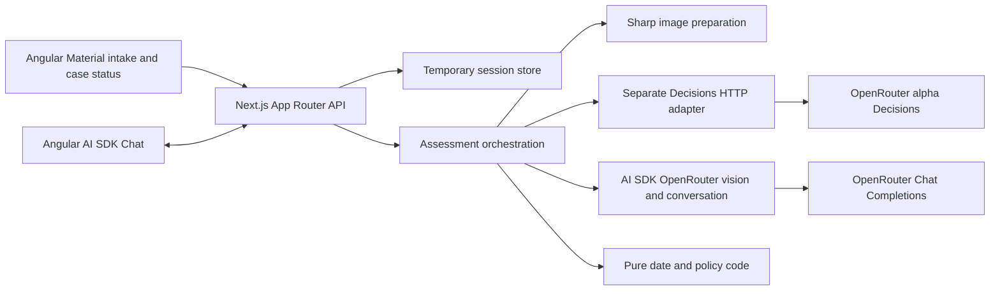
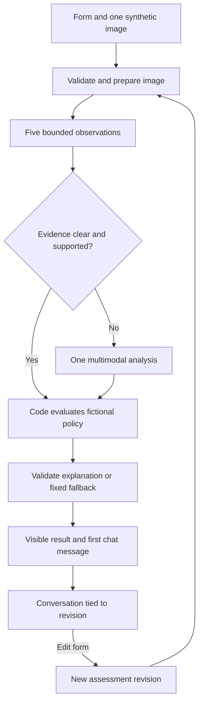
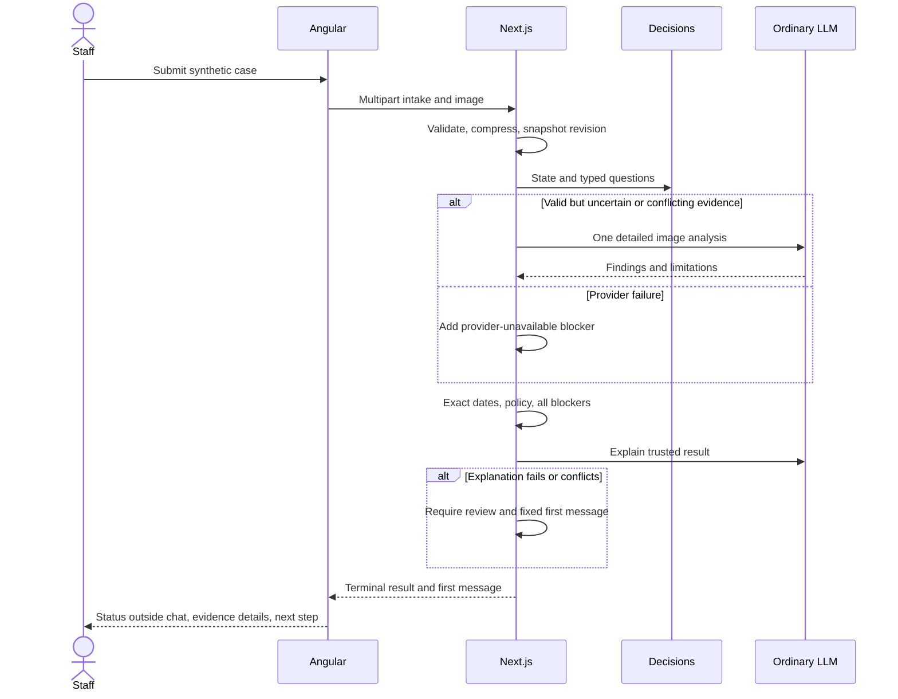

# ADR-000: Hardware Service Decision Copilot - Main Architecture

**Date:** 2026-11-06
**Status:** Accepted for the local implementation through the user's explicit request to implement the plan on 2026-11-06. Runtime/provider verification and final acceptance remain pending.
**PRD:** [Decision Model Variant](../PRD.md)
**Related:** [Angular and chat](001-angular-and-streaming-chat.md), [bounded Decisions assessment](002-bounded-decisions.md)

## 1. Overview and confirmed scope

Build a small synthetic-only course PoC: intake and one image -> bounded observations -> optional detailed image analysis -> code-owned policy result -> explanation and chat. Staff make final decisions. There are no external actions, refunds, automated refusals, authentication, database, RAG, or durable histories.

The user confirmed the fictional inclusive 30-day return and 12-month complaint windows, review for any supported return damage, and explicit form reassessment for changes. Retain all five PRD observations: usability, relevance, cracks, dents/deformation, scratches. Each answers a different prerequisite or policy question; dropping one would leave a defined acceptance scenario unsupported.

The later instruction selects **Angular and Angular Material for the entire frontend**, replacing the earlier React/assistant-ui choice. Retain the earlier explicit Next.js App Router requirement for the **backend routes only**. This creates two local processes, not two user interfaces. Local-only deployment is an assumption because the deployment question was unanswered. The user accepts temporary memory and loss on refresh/restart, and requests a small live smoke check plus 10-20 synthetic evaluation cases.

These records supersede the draft root-level ADR-001 and ADR-002. No app or integration was implemented during this research.

## 2. Technology Documentation References

Historical research record: documentation was checked on 2026-11-06. Future lookups follow AGENTS.md: delegate research to Luna, use Context7 first; for CLI behavior use installed help first, then Context7, with official web sources only for remaining gaps or explicitly requested links. Context7 resolved Vercel AI SDK by name before querying; returned `/vercel/ai` with version `ai_7.0.0`. Queries used `/vercel/ai/ai_7.0.0` for streaming, multimodal input, evaluation, and subsequently the Angular integration. Context7 examples can lag newer patch APIs; the provider README and inspected source settle those details.

| Technology | Verified Context7 ID or official source | Purpose |
| --- | --- | --- |
| AI SDK | `/vercel/ai`, version `/vercel/ai/ai_7.0.0`; [docs](https://ai-sdk.dev/docs), [repository](https://github.com/vercel/ai) | Server generation, typed UI messages, Angular chat transport |
| Angular | `/angular/angular` | Standalone frontend and reactive forms |
| Angular Material/CDK | `/angular/components`; [getting started](https://material.angular.dev/guide/getting-started) | Form controls, status, accessible layout |
| Next.js | [App Router CLI](https://nextjs.org/docs/app/api-reference/cli/create-next-app) | Server-only API application |
| OpenRouter provider | [integration guide](https://openrouter.ai/docs/guides/community/vercel-ai-sdk), [provider source](https://github.com/OpenRouterTeam/ai-sdk-provider) | Ordinary chat and vision model access |
| Decisions | [API reference](https://openrouter.ai/docs/api/api-reference/alphadecisions/submit-a-decisions-request) | Separate typed assessment protocol |
| Sharp | [constructor](https://sharp.pixelplumbing.com/api-constructor/), [resize](https://sharp.pixelplumbing.com/api-resize/), [output](https://sharp.pixelplumbing.com/api-output/) | Decode limits, compression, metadata removal |

## 3. System architecture and repository

Use a small application with an Angular SPA and one Next.js Node backend. No agent framework, queue service, WebSocket server, or distributed store is needed. Angular sends relative `/api/**` requests through its development proxy to the backend; provider calls originate only on the backend. The [Angular proxy guide](https://angular.dev/tools/cli/serve#proxying-to-a-backend-server) documents the double-star path matching needed for nested routes.

| Layer / directory | Selection and responsibility |
| --- | --- |
| `web/` | Angular 21 standalone application, strict TypeScript and strict templates, Material/CDK on the same major. Angular 21 matches the inspected official chat example; do not mix its packages with Angular 22. |
| `api/` | Next.js App Router with strict TypeScript; route handlers use Node runtime, not Edge. No React application UI. |
| `api/src/server/assessment/` | Revision orchestration, immutable results, provider deadlines and failure states |
| `api/src/server/providers/` | Separate OpenRouter conversation/vision and Decisions adapters |
| `api/src/server/policy/` | Pure validation, calendar rules, thresholds, blocker accumulation |
| `api/content/` | Separate versioned return/complaint policies and explanation prompts, initially from PRD appendices |
| `api/src/server/sessions/` | Bounded in-process store, authoritative history, compressed image buffers |
| `docs/ADR/` | These architecture decisions; documentation stays outside generated applications |

Use Node.js 24 LTS as the planned common runtime; check resolved Angular/Next.js engine compatibility before installation. The current OpenRouter provider requires Node 22+ and ESM ([source](https://github.com/OpenRouterTeam/ai-sdk-provider)). Use npm and commit lockfiles in each application. No Nx/Turborepo or shared runtime package is required for this size.

Dependencies point inward: routes -> orchestration -> pure policy and provider interfaces. Provider adapters implement those interfaces; policy imports no SDK. UI imports public contracts, never server configuration. The server owns policy status and history; browser message bodies cannot replace either.

## 4. Initialization decision

**Selected chat starting point:** the official [AI SDK Angular example](https://github.com/vercel/ai/tree/6737c7721b10ce489e21efff43a4acf9c8ca7f04/examples/angular), inspected through GitHub source at commit `6737c7721b10ce489e21efff43a4acf9c8ca7f04`. It includes an Angular `Chat` client, streaming message rendering, composer, pending indicator, Stop control, a proxy, and an Express streaming backend. It is a reusable example, **not a turnkey Angular Material product template**. See ADR-001 for the exact inventory and alternatives.

After plan approval, initialize a standalone Angular CLI shell and transplant the example's chat component/template/styles and transport pattern. Do not copy its workspace manifest verbatim: it contains `workspace:*` dependencies and TypeScript references to the upstream monorepo. Add Material and use its controls in the reused chat. Move the example's server streaming pattern to Next.js routes and use OpenRouter explicitly instead of its default AI Gateway. Remove weather tools, debug message dumps, reasoning rendering, completion demo and structured-object demo.

Record these commands in the implementation plan; **do not execute them while writing ADRs**:

1. From repository root: `npx @angular/cli@21 new hardware-service-web --directory web --standalone --routing --style=scss --strict --package-manager=npm --skip-git`.
2. From `web/`: `npx ng add @angular/material@21`.
3. From repository root: `npx create-next-app@latest api --ts --eslint --app --src-dir --use-npm --import-alias "@/*" --skip-git`. Choose no Tailwind/React Compiler extras if prompted; only API routes are needed.
4. Resolve released compatible packages and pin exact versions: `ai@7`, `@ai-sdk/angular@3`, `@openrouter/ai-sdk-provider` on its AI SDK 7 line, schema validation, and Sharp. The inspected Angular package was 3.0.163; this is research evidence, not an instruction to combine unverified patch versions. Verify both apps use the same compatible AI SDK release and strict mode.

The CLI commands are supported by [Angular CLI](https://angular.dev/cli/new), [Material schematics](https://github.com/angular/components/blob/main/guides/schematics.md) and [create-next-app](https://nextjs.org/docs/app/api-reference/cli/create-next-app). No single fully verified template already contains Angular Material, our Next.js backend, OpenRouter and Decisions. The adaptation work must remain visible in the plan.

## 5. Data models and retention

| Entity | Conceptual fields and ownership |
| --- | --- |
| Intake | Case type enum; category enum; trimmed model/name up to 200 characters; reason up to 4,000 characters, required for complaints; purchase date as ISO date-only; exactly one image |
| PreparedImage | Opaque ID, JPEG/PNG media type, width/height, byte length, hash, compressed bytes, preparation warnings; server-owned |
| AssessmentRevision | Case ID, increasing revision, request/idempotency ID, assessment date/timezone, form snapshot, image ID, stage, model/question/threshold/policy versions, initial observations, optional analysis, all blockers, final status, first assistant message |
| Observation | Fixed proposition ID; raw provider probability nullable; usable probability nullable; code-derived label; provenance; evidence description nullable; explicit limitations; initial and resolved findings remain separate |
| DetailedAnalysis | Per-observation resolved label, visible evidence and limitations; conflict/unsupported-condition flags; no fabricated replacement probabilities |
| PolicyResult | `preliminary_recommendation` or `human_review_required`; recommendation enum when allowed; blocker codes and staff next steps; advisory notice |
| Conversation | Revision ID, server-owned ordered UI messages, message IDs, completion/interruption state; no cross-revision implicit merging |

Keep browser draft, image preview and conversation in memory only. Keep server sessions for at most 60 minutes idle and 4 hours absolute, at most 20 sessions, 10 revisions/session, and 25 MiB of compressed image bytes globally. Reject capacity or revision overflow visibly; do not silently discard active context. Clear on Start new case, expiry or restart. No localStorage, IndexedDB, database, image files, or body logging. Destroy browser object URLs when replacing/removing images. Expired/missing context requires reassessment; refresh starts a new browser session.

A random opaque HttpOnly SameSite session cookie binds all case/revision lookups. Reject cross-session IDs and mismatched request origins. This is local session isolation, not authentication. Deploying beyond a local single-instance demo is a review trigger, because memory and in-flight requests are not durable.

## 6. API contracts

| Endpoint | Input and output | Failure / invariant |
| --- | --- | --- |
| `POST /api/assessments` | Multipart intake and one image; optional existing case ID and expected revision; idempotency ID. After validation/preparation, return an SSE progress stream with case/revision, stage and one terminal result including first message. | 422 fields/corrupt image; 413 upload/body limits; 409 stale revision or duplicate active submission; no model calls for invalid input. Once streaming starts, failures are typed terminal events. |
| `GET /api/assessments/{caseId}` | Session-bound lookup; current revision, stage/result and interruption status, no provider credentials or image bytes | 404 inaccessible ID; 410 expired context; used to reconcile a disconnected assessment request |
| `POST /api/chat` | Current case/revision, stable message ID and new user text up to 4,000 characters; AI SDK transport envelope may include history but server reconstructs authoritative history | AI SDK UI message stream; 409 stale/not-ready revision; 410 missing context; 413 context/body budget. No Decisions call or policy mutation. |
| `DELETE /api/cases/{caseId}` | Session-bound case ID | Clear memory and abort active work; idempotent completion |

Assessment SSE is an application progress contract, not a raw provider stream and not the chat UI protocol. Events carry increasing sequence numbers and the revision. The browser shows validation/image preparation while waiting for the response; subsequent server stages are observation assessment, optional detailed analysis, policy and explanation. Work runs inside the active request, avoiding detached background jobs. Disconnect aborts upstream work and records interrupted/review-required status when a revision exists. An explicit retry creates a new revision; it is never an invisible second escalation in the same revision.

## 7. Environment variables

Start from the existing root `.env.example`, which contains `OPENROUTER_API_KEY` and `LLM_MODEL`; preserve both names. The example contract is extended without real credentials. The user-designated Git-ignored `secrets/openrouter.env` supplies the local key and selected `LLM_MODEL`/`DECISION_MODEL` settings; this records the configuration contract without inspecting the file. At implementation, the backend application runtime, not the agent, explicitly loads that file into its server environment (process environment takes precedence and examples do not overwrite supplied selections); do not assume Next.js automatically loads this custom path or duplicate the key in `api/.env.local`. Non-secret backend settings may use ignored `api/.env.local`. Angular never loads either secret file or root provider variables. Agents and workers must not open, inspect, print or attach secret files/values. Implement and test the loader using synthetic configuration values only; a human or credential-isolated runtime supplies real credentials for live checks and returns sanitized results. Missing required provider configuration produces a visible review-required assessment, not a mock masquerading as live integration.

| Variable | Required / example | Meaning |
| --- | --- | --- |
| `OPENROUTER_API_KEY` | Yes; empty placeholder | One server-side key can authenticate both protocols |
| `LLM_MODEL` | Yes; empty placeholder; proposed `openai/gpt-6-luna` | Ordinary text-generating chat/explanation model, subject to live checks |
| `VISION_MODEL` | No; empty means `LLM_MODEL` | Optional ordinary multimodal escalation model override |
| `DECISION_MODEL` | Yes; `openai/gpt-6-luna-decisions` | Independent initial decision model; never substituted into `streamText` |
| `OPENROUTER_DECISIONS_URL` | Default `https://openrouter.ai/api/alpha/decisions` | Explicit separate protocol endpoint |
| `DECISIONS_TIMEOUT_MS` | `30000` | Initial assessment deadline |
| `LLM_TIMEOUT_MS` | `60000` | Detailed image analysis and follow-up chat deadline |
| `EXPLANATION_TIMEOUT_MS` | `30000` | Initial explanation deadline |
| `ASSESSMENT_TIME_ZONE` | `Europe/Warsaw` | Date-only policy clock |

The ordinary OpenRouter provider uses its documented `/api/v1` base and Chat Completions surface. No provider keys belong in Angular environment files, browser requests, generated assets or committed real values. Do not rename `LLM_MODEL` to a new chat-model variable. Timeouts are configurable operational limits, not latency claims.

## 8. Technical decisions and consequences

| Decision | Status/date; rationale and rejected option | Consequence / review trigger |
| --- | --- | --- |
| Angular SPA + Next.js API | Proposed, 2026-11-06. Honors Angular frontend update and earlier Next backend requirement; reject React islands and an additional Express backend. | Two local processes. Revisit if the user removes the Next.js constraint or requests deployment. |
| One in-memory local backend | Proposed, 2026-11-06. Matches accepted temporary sessions; reject DB/job infrastructure for this slice. | Sessions disappear; revisit before multi-instance/serverless hosting or real cases. |
| Ordinary AI SDK provider plus separate Decisions HTTP adapter | Proposed, 2026-11-06. Different contracts and failure handling; reject treating a decision model as a streaming chat model. | Two integration smoke checks; revisit adapter on stable evaluation support. |
| Deterministic status and dates | Proposed, 2026-11-06. Fictional rules are exact and testable; reject LLM eligibility/date arithmetic. | All blockers accumulate; revisit only with versioned policy changes. |

Calendar code uses inclusive purchase+30 days and the inclusive 12-month anniversary; clamp February 29 anniversaries to the last day of February. Future dates are invalid; older valid dates are policy exceptions. Missing policy/prompt inputs or any required provider failure result in review. A successful image analysis cannot clear a policy exception.

## 9. Diagrams

### Component architecture

### Data flow

### Assessment and failure sequence

## 10. Testing and approval gates

Use TDD for pure routing/date rules and provider boundary validation. Unit and integration tests use Vitest; Angular component tests use TestBed and Material harnesses; Playwright covers the browser-to-API journey. Mock responses prove routing only. No claim of provider integration is complete until the separate live checks in ADR-002 pass.

| Layer | Required verification |
| --- | --- |
| Pure policy | PRD A04-A12, exact threshold boundaries, all blockers, leap-day/date-only timezone cases |
| Input/image | A01-A03; file signatures, corrupt files, animation, decoded pixel bounds, metadata/orientation and compression-detail fixtures |
| Provider/API | A08-A10/A13/A18-A20; malformed output, outage, timeouts, missing policy, prompt injection, one escalation maximum |
| UI/session | A14-A17; authoritative status, complete context, cancellation, duplicate submit, superseded revision, expiry and responsive keyboard use |

- TAC-000-01: Both apps build with strict TypeScript; Angular strict templates are enabled, and no provider secret appears in frontend build output.
- TAC-000-02: Every PRD A01-A21 scenario maps to a passing automated behavior check before demo acceptance.
- TAC-000-03: Chat never invokes Decisions or mutates policy status; stale revisions and forged assessment data are rejected.
- TAC-000-04: Any required provider failure produces review-required status and retained editable form data; no clean-result default exists.
- TAC-000-05: Only compressed, metadata-stripped evidence is forwarded, and expired sessions cannot be used as conversation context.

Approval must cover the local-only assumption, starter adaptation rather than a turnkey Material template, and the proposed implementation/evaluation budget. The product owner accepted the initial nullable-rationale contract in ADR-002 on 2026-11-06; PRD A21 now records it. The implementation plan must include the actual scaffold/import work, provider integrations and a separate live smoke milestone. Broader deployment, real cases and calibrated accuracy remain outside this PoC.
