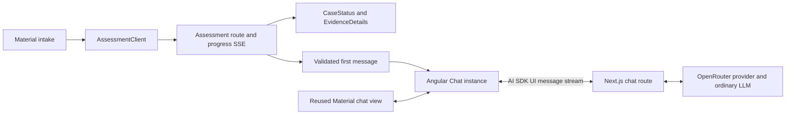

# ADR-001: Angular Material Frontend and Streaming Chat

**Date:** 2026-11-06
**Status:** Accepted for local implementation through the user's explicit implementation request on 2026-11-06; replaces the React/assistant-ui frontend proposal. Runtime verification remains pending.
**Relates to:** [Main architecture](000-main-architecture.md)

## 1. Scope

Select a verifiable Angular chat starting point, frontend components and stream transport. Define how intake, assessment, result and revision-bound conversation use the Next.js API. Provider assessment semantics are in [ADR-002](002-bounded-decisions.md).

## 2. Technology Documentation References

| Technology | Verified Context7 ID or primary source | Used for |
| --- | --- | --- |
| AI SDK Angular | `/vercel/ai/ai_7.0.0`; [package README](https://github.com/vercel/ai/blob/main/packages/angular/README.md) | Angular `Chat`, not React `useChat` |
| Official Angular example | [Pinned example](https://github.com/vercel/ai/tree/6737c7721b10ce489e21efff43a4acf9c8ca7f04/examples/angular) | Selected reusable chat starter |
| Angular | `/angular/angular`; [CLI](https://angular.dev/cli/new) | Standalone strict application |
| Material/CDK | `/angular/components`; [component catalog](https://material.angular.dev/components/categories) | Native Angular UI |
| AI SDK streams | [chatbot](https://ai-sdk.dev/docs/ai-sdk-ui/chatbot), [custom data](https://ai-sdk.dev/docs/ai-sdk-ui/streaming-data) | UI stream response and progress data |
| OpenRouter | [AI SDK integration](https://openrouter.ai/docs/guides/community/vercel-ai-sdk) | Backend model provider |

Context7 verified the Angular package's `Chat`, reactive message/status properties and `stop()` method. Live GitHub reads verified the actual example files and package manifest. The example README still says Angular 20, while its manifest uses Angular 21.2.x; use the manifest as version evidence and normalize compatible Angular patches during initialization.

## 3. Selected starter: exact inventory and remaining work

Select `vercel/ai/examples/angular` at research commit `6737c7721b10ce489e21efff43a4acf9c8ca7f04`. Reuse its existing basic chat UI; do not design a chat client from scratch.

| Requirement | Verified source | Already present? / adaptation |
| --- | --- | --- |
| Angular frontend | `examples/angular/package.json` | Yes; standalone component, Angular 21.2.x dependencies |
| AI SDK client | `src/app/chat/chat.component.ts` | Yes; `Chat` from `@ai-sdk/angular`, form validation and message submission |
| Streaming display | `src/app/chat/chat.component.html` | Yes; message parts update during streaming, waiting indicator and Stop control |
| Basic chat UI | Same template plus `chat.component.css` | Yes; message list, user/assistant distinction and composer; native HTML/CSS, not Material |
| Streaming backend | `src/server.ts` | Yes; Express uses `streamText`, asynchronous `convertToModelMessages`, `toUIMessageStream` and `pipeUIMessageStreamToResponse` |
| Angular Material | Not in example manifest | Add Material/CDK, theme and controls; keep existing message/transport structure |
| Next.js API | Example backend is Express | Port server pattern to route handlers; do not run Express as a third process |
| OpenRouter | Example defaults to AI Gateway | Replace with explicit server OpenRouter provider; choose model server-side |
| Decisions and assessment | Not present | Separate planned integration, never implied by the starter |

The pinned [chat component](https://github.com/vercel/ai/blob/6737c7721b10ce489e21efff43a4acf9c8ca7f04/examples/angular/src/app/chat/chat.component.ts), [template](https://github.com/vercel/ai/blob/6737c7721b10ce489e21efff43a4acf9c8ca7f04/examples/angular/src/app/chat/chat.component.html), [server](https://github.com/vercel/ai/blob/6737c7721b10ce489e21efff43a4acf9c8ca7f04/examples/angular/src/server.ts), and [manifest](https://github.com/vercel/ai/blob/6737c7721b10ce489e21efff43a4acf9c8ca7f04/examples/angular/package.json) were inspected individually. The example is inside a monorepo: replace `workspace:*` dependencies and upstream TypeScript project references using the generated CLI application. Do not claim that copying its folder and running npm is already a standalone install.

No build or browser smoke check was run on the example during ADR research. Source verification establishes the available pattern, not a tested integration in this repository.

## 4. Alternatives and selection record

**Status:** Proposed. **Date:** 2026-11-06. **Context:** Angular Material is now required; a React UI integration no longer fits. **Decision:** use the official Angular example and SDK transport, and Material controls around its reused chat UI. This keeps one conversation store and avoids adapting another streaming protocol. **Consequences:** a small amount of Material styling/composition remains. **Review trigger:** the retained example UI fails keyboard/accessibility tests or its Angular integration cannot pass the local stream smoke check.

| Candidate | Research findings and fit |
| --- | --- |
| Official AI SDK Angular example - selected | Verified source contains the client, stream, composer and basic chat UI. Needs Material and backend/provider adaptation, explicitly listed above. |
| [angular-generative-ui-chat](https://github.com/shteynu/angular-generative-ui-chat) | Repository page describes Angular 22, Material, AI SDK streaming and ngx-json-render, with a Cloudflare Worker backend. However GitHub API source-tree verification returned 404 and file retrieval failed. Candidate only; not selected as a verified cloneable starter. Generative UI and its Worker backend also add adaptation outside our requested stack. |
| [@trixwell/ngx-parl](https://github.com/Trixwell/parl) | Ready Angular Material chat UI; documentation exposes message list/update inputs and actions. No verified AI SDK UI stream adapter. Would still need a message mapping layer and stop/retry handling; repository/package license labels differ, so the installed artifact needs checking if reconsidered. Not chosen over the already verified official example. |
| [Deep Chat](https://deepchat.dev/docs/connect/) | Ready web component, custom handlers and SSE/ReadableStream support. Can live inside Angular, but is not a native Material component. Its response format is different from AI SDK UI messages, so a handler/adapter is required. Do not assume generic SSE support means protocol compatibility. |
| [ngx-prompt-kit](https://ngx-prompt-kit.pianonic.ch/) | Angular signal-based AI UI with streaming-oriented primitives, distributed through schematics. It composes with Spartan UI, adding another design system beside Material. |
| [NeuroDevWorks Angular Chatbot](https://github.com/NeuroDevWorks/angular-chatbot-ai) | Advertises Material UI and streaming, but its quickstart passes provider credentials into frontend configuration and uses its own provider/client layer. That documented path conflicts with server-only keys; adapting it offers no clear advantage here. |
| assistant-ui | The investigated [runtime matrix](https://www.assistant-ui.com/docs/runtimes/ai-sdk/overview) and [v7 guide](https://www.assistant-ui.com/docs/runtimes/ai-sdk/v7) cover React hooks. Not selected for Angular; do not introduce a React island to preserve the earlier choice. |
| AI Elements | [Current site](https://elements.ai-sdk.dev/) announces migration to shadcn/ui and deprecation at the end of November 2026. It does not supply the required native Angular Material solution. |
| Chat SDK at chat-sdk.dev | [Current homepage](https://chat-sdk.dev/) describes a cross-platform bot SDK, not the web-chat template assumed in the original brief. Slack/Teams/etc. are outside this PoC. |
| Direct OpenRouter Responses | [Current docs](https://openrouter.ai/docs/api_reference/responses/overview) define a stateless `/api/v1/responses` API; full history is required, while `store: true` and non-null `previous_response_id` are rejected. It is an alternative backend model protocol, not a chat component or Decisions endpoint. It adds no needed feature over the selected provider path. |

## 5. Component design and data ownership

| Component / service | Responsibilities and dependencies |
| --- | --- |
| `IntakeForm` | Typed reactive form; Material select, form-field/input, datepicker and validation; one native file input with preview/replace/remove. Complaint reason required. |
| `AssessmentClient` | Multipart submission and assessment SSE events. Stores current request ID/revision and rejects stale events. Separate from conversation transport. |
| `CaseStatus` | Material card/banner with persistent recommendation or review status, all blockers and next steps. Reads the structured server result, never parses generated prose. |
| `EvidenceDetails` | Material expansion panels/table: proposition probabilities, derived labels, provenance, limitations, detailed analysis and versions. No overall eligibility confidence. |
| `ChatSession` | One Angular AI SDK `Chat` instance per revision, seeded with the validated first assistant message; `DefaultChatTransport` targets `/api/chat`. |
| Reused `ChatComponent` | Existing message list and composer adapted to Material inputs/buttons/icons, streaming/error/stop controls and accessible status announcements. No extra provider client. |
| `CasePage` | Draft -> processing -> result/chat; explicit Edit form and Start new case. Previous revisions stay visually distinguishable and read-only. |

Use signals for local stage and current revision; reactive forms for field validation. Do not add NgRx. Do not duplicate chat history in a component, RxJS store and SDK instance. Use HttpClient for ordinary JSON/multipart requests where convenient; the SDK's fetch-based transport owns conversation streaming. The application-specific assessment event reader uses fetch and AbortController. Native EventSource alone is unsuitable for the POST/multipart assessment request.

Render escaped text by default. The first message uses trusted headings and bullet structure assembled from the result. Model-provided HTML, arbitrary UI specifications and tool/debug payloads are not rendered. Images are edited through intake and reassessment; chat attachments cannot silently introduce new assessed evidence.

## 6. Streaming and backend contracts

The originally requested `streamText` + `useChat` pattern is valid for React. Its Angular equivalent is **server `streamText` + client `Chat` from `@ai-sdk/angular`**, using the same AI SDK UI message protocol. There is no React hook in the Angular app. Follow the inspected example rather than renaming a React hook.

In Next.js `POST /api/chat`, validate the current revision and message ID, reconstruct trusted full history, asynchronously convert validated UI messages, and use the explicit OpenRouter chat model. The current v7 route pattern returns `createUIMessageStreamResponse` around `toUIMessageStream({ stream: result.stream })`. Do not use an old chained response helper or forward raw OpenRouter Chat Completions/Responses events directly to the Angular client. This translation is the SDK's job ([current chatbot guide](https://ai-sdk.dev/docs/ai-sdk-ui/chatbot)).

The server accepts user text, not client-supplied system instructions, policy outcomes, provider selection or model IDs. Remove the starter's `selectedModel` trust path and fake weather tool. Use full current-revision form data, assessment date, initial probabilities, detailed analysis, policy version/text, deterministic result, first message and all current messages. Estimate context against the configured model limit with output reserve; if it cannot fit, stop with a visible reassessment instruction. Never silently prune critical evidence or summarize away blockers.

Status-changing conclusions are not streamed as unchecked prose. The initial explanation is buffered and validated against the structured result before becoming the first assistant message. For follow-ups, use a schema-validated answer plan selecting supported topics (why, findings, missing evidence, next steps, fictional policy, edit/reassess) and references to existing findings/blockers; render assessment claims, status and actions from trusted text. Unsupported questions receive a fixed scope explanation. This bounded presentation is an explicit PoC tradeoff: the ordinary LLM interprets conversational questions, but cannot invent new case facts or free-form eligibility conclusions. It remains a separate generative-model call, not a Decisions request.

Use `streamText` for generation and the SDK UI stream for delivery; buffer assessment-bearing answer content until its plan validates, then emit the validated text sections through the UI message stream. This delays visible answer text compared with raw token forwarding. Do not describe it as immediate provider-token streaming. A regex or an LLM confidence score cannot prove arbitrary prose is grounded. If later free-form case-specific prose is required, revisit this release gate and its acceptance tests explicitly.

Cancellation aborts upstream calls where supported. A user stopping later chat leaves the assessment unchanged and the partial turn marked interrupted. A failed initial explanation is a required-provider failure: add review status and seed a deterministic fallback message. Later chat outages show a recoverable chat error without silently rewriting an already completed assessment. Retry resends the interrupted conversational turn with stable identifiers, not a new Decisions assessment.

## 7. Diagrams

### Components and transport



### Conversation, interruption and reassessment

```mermaid
sequenceDiagram
  actor Staff
  participant UI as Angular Chat
  participant API as Chat route
  participant L as Ordinary LLM
  Staff->>UI: Ask why / missing evidence / next step
  UI->>API: New message and current revision
  API->>API: Load full authoritative context
  API->>L: streamText with bounded answer contract
  L-->>API: Answer plan
  API->>API: Validate references and render trusted case claims
  API-->>UI: SDK UI stream of validated sections
  alt Stop or network failure
    UI->>API: Abort request
    API->>L: Cancel where supported
    UI-->>Staff: Interrupted turn, unchanged case status
  end
  Staff->>UI: Edit form and resubmit
  UI->>API: Abort old turn; reject stale revision
  Note over UI,API: Assessment endpoint creates new revision and new chat
```

## 8. Testing strategy and technical acceptance criteria

Use TestBed/Material harnesses for controls, Vitest for message mapping and API boundaries, and Playwright for streaming/revision flows. Write behavior tests with deterministic stream chunks before connecting a paid model.

| Scenario | Input | Expected behavior |
| --- | --- | --- |
| Stream framing | UI stream split at arbitrary bytes, including multibyte text | One coherent assistant message; SDK handles framing; no custom Chat Completions parser |
| Pending/stop/retry | Delayed stream, stop, provider error, retry | Accessible states; upstream cancellation; no duplicate committed turn |
| First message | Assessment with each recommendation/review outcome | One seeded message, correct status outside chat; no second assessment call |
| Stale revision | Old response arrives after Edit form | Old stream cannot overwrite new status or chat |
| Contradictory answer plan | Unsupported claim/blocker reference or conflicting status | Withhold content; fixed grounded explanation, no status override |
| Context overflow/expiry | Full history unavailable or too large | Explicit new-assessment request; no invisible truncation |
| Injection/HTML | Malicious form/image text or chat instructions | No policy override, executable markup, tools or provider-key disclosure |
| Accessibility | Keyboard-only input, status update, narrow viewport | Labels/focus/announcements work; no horizontal page scrolling |

- TAC-001-01: The chosen starter is identified by URL and inspected commit, with a clear present-versus-adaptation inventory.
- TAC-001-02: Angular consumes the real backend UI stream through the official `Chat` transport; no React runtime or browser provider key is required.
- TAC-001-03: Initial and later assessment claims are released only from a validated answer contract; generated content cannot change the structured status.
- TAC-001-04: One current revision has one chat instance and complete authoritative context; old histories are visibly superseded.
- TAC-001-05: A separate browser smoke check demonstrates two-turn context, stream delivery, cancellation and a visible failure through the actual Angular proxy and Next.js route.
