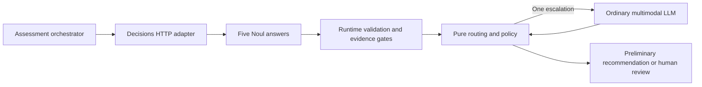
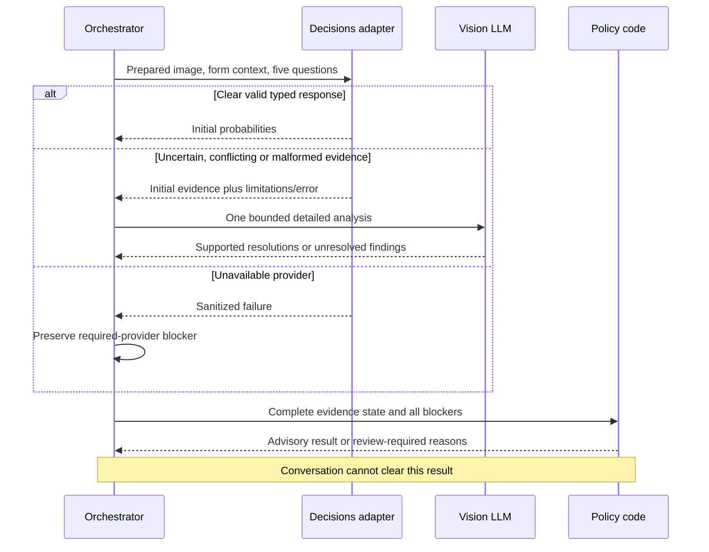

# ADR-002: Bounded Visual Assessment through OpenRouter Decisions

**Date:** 2026-11-06
**Status:** Accepted for local implementation through the user's explicit implementation request on 2026-11-06, including the nullable-rationale clarification. Live access and evaluation remain implementation gates.
**Relates to:** [Main architecture](000-main-architecture.md), [Angular and chat](001-angular-and-streaming-chat.md)

## 1. Scope and recommendation

Use **`openai/gpt-6-luna-decisions` through `POST https://openrouter.ai/api/alpha/decisions`**, behind a small server-only HTTP adapter, for the first bounded assessment. Keep dates and fictional policy checks in code. Use an ordinary multimodal LLM for at most one uncertainty escalation and for subsequent explanations/conversation. This selection favors simpler image handling for the PRD, not a demonstrated accuracy advantage.

The normal model proposed for both escalation and chat is **`openai/gpt-6-luna`**. Its [OpenRouter model page](https://openrouter.ai/openai/gpt-6-luna) documents image input, text output and structured outputs. It is distinct from the Decisions model. Configure through the existing `LLM_MODEL`; leave the example value empty until the implementation verifies access and both vision/streaming capabilities. `VISION_MODEL` can override escalation without changing conversational history or the Decisions protocol.

## 2. Technology Documentation References

Historical research record, checked 2026-11-06: the requested official sources included the Jev guide, multimodal Decisions guide, API reference, Noul, confidence and Luna Decisions page. This is not a future source-order instruction. Future research is delegated to Luna under AGENTS.md: Context7 first, installed help first for CLI questions, then Context7, and official web sources only for remaining gaps or explicitly requested links.

| Source | Verified ID or official URL | Decision evidence |
| --- | --- | --- |
| AI SDK | `/vercel/ai/ai_7.0.0` | Streaming/multimodal core; Context7 evaluation query did not establish the newer adapter API |
| Jev guide | [OpenRouter Jev](https://openrouter.ai/docs/guides/community/jev) | Current IDs, primitives, endpoints, early-image warning |
| Jev model | [Jev 1.14](https://openrouter.ai/typesafe/jev-1.14) | Model identity and current catalog context |
| Multimodal Decisions | [Official guide](https://openrouter.ai/docs/guides/community/multimodal-decisions) | Image positions, encoding, limits and provider adapters |
| Decisions API | [Submit a request](https://openrouter.ai/docs/api/api-reference/alphadecisions/submit-a-decisions-request) | Wire request/response and errors |
| Noul | [TypeSafe Noul](https://docs.typesafe.ai/primitives/noul) | Probability of yes; no separate confidence field |
| Confidence | [TypeSafe confidence](https://docs.typesafe.ai/confidence) | Choice/Score distribution semantics; risk-dependent routing |
| Luna Decisions | [Model page](https://openrouter.ai/openai/gpt-6-luna-decisions) | Text/image input, typed outputs, question limit and regional limitation |
| SDK adapter | [OpenRouter provider README](https://github.com/OpenRouterTeam/ai-sdk-provider#evaluation-jev-with-ai-sdk-through-openrouter) | Existing evaluation/decision adapter and experimental dependency |
| SDK alternate path | [OpenRouter TypeScript Decisions SDK](https://openrouter.ai/docs/client-sdks/typescript/sdks/decisions/README.md) | `alpha.decisions` surface; documentation index identifies it, but direct web retrieval failed |
| Structured generation | [AI SDK structured data](https://ai-sdk.dev/docs/ai-sdk-core/generating-structured-data) | Ordinary LLM escalation output validation |

Older [Jev tutorial](https://openrouter.ai/blog/tutorials/how-to-use-jev/) and [Jev-versus-LLM article](https://openrouter.ai/blog/tutorials/jev-vs-llm-when-to-use-each/) still discuss 1.13 and older image restrictions. Use the current model/multimodal guides for capability decisions, rather than extrapolating those older examples.

## 3. Model and API comparison

| Candidate | Verified capabilities and differences | Fit |
| --- | --- | --- |
| `typesafe/jev-1.14` | Text/images; Noul, Choice, Score and Box. `~typesafe/jev-latest` is a moving alias; 1.13 remains available. OpenRouter exposes Decisions and a separate System One surface for the TypeSafe SDK. Typed answers, no prose rationale. | Suitable alternative. Box/localization is unnecessary for the five observations. Pin a version if selected. |
| `openai/gpt-6-luna-decisions` - selected | Text/images; Noul, Choice and Score, up to 200 questions, typed output instead of chat text. No Box. Current model page says no EU in-region routing. | Fits five questions with one ordinary image; no requirement for localized damage boxes. Synthetic-only scope accommodates the regional limitation; real/EU-restricted data would require a new decision. |

Image handling is not interchangeable. The [multimodal guide](https://openrouter.ai/docs/guides/community/multimodal-decisions) allows JPEG/PNG/WebP data URLs generally; Jev accepts JPEG/PNG only and requires each dimension 256-1,568 pixels plus total-pixel limits. Jev images use its long-context mode and early-feature contract. Luna reads image parts only as top-level `state` array items; Jev also supports nested positions. Thus the PRD's 1,600-pixel longest edge is not a drop-in Jev request. The selected adapter emits one top-level JPEG/PNG data URL for Luna. Its upstream effective limits still need a smoke check; catalog image-count limits are not upload-size guarantees.

**Decision record - provider selection.** Status: Proposed. Date: 2026-11-06. Context: both candidates now document image support, but their media restrictions differ. Decision: Luna Decisions for the first slice, retaining a provider-neutral normalized observation model. Rejected alternative: Jev 1.14 adds image-size/early-feature constraints without a required Box feature. Consequences: no evidence that Luna is more accurate, calibrated or faster on hardware images; evaluate before relying on it. Review trigger: live image requests fail, wrong clear-condition findings occur on held-out cases, or regional/privacy requirements change. Comparing multiple providers is optional, not part of the initial implementation.

## 4. Separate adapter and wire contract

An AI SDK adapter **does exist**: the provider README documents `decisionModel()` / `evaluationModel()` with `experimental_evaluate` in `ai@7.0.103+`. SDK `boolean` maps to wire `noul`, exposed as `probability`; Choice/Score retain distributions, while additional confidence/cost metadata has a separate provider metadata location. It targets alpha Decisions, not the chat stream. Do not claim no suitable SDK adapter exists just because an older Context7 example lacks it.

**Decision record - direct HTTP boundary.** Status: Proposed. Date: 2026-11-06. Context: this PoC needs explicit image placement and raw typed probability validation, while the evaluation API remains experimental. Decision: use a small direct HTTP adapter returning normalized observations and sanitized metadata. Rejected alternatives: experimental evaluation adapter adds another upgrade surface; the OpenRouter SDK is viable but not necessary for one request; TypeSafe SDK/System One is a Jev-specific alternate surface, not the selected Luna endpoint. Consequences: maintain request validation locally. Review trigger: evaluation APIs stabilize and pass image/metadata parity tests with less maintenance.

| Boundary | Conceptual contract |
| --- | --- |
| Adapter input | Prepared image, category/model description and reported reason as untrusted data; fixed question version; configured model; abort signal/deadline |
| Wire request | Bearer key; `model`, `state`, `questions`. `state` is a top-level array with plain text strings and one `image_url` object containing a base64 data URL. Five question IDs map to `type=noul`, instructions and optional paired true/false criteria. |
| Wire response | `answers` keyed by requested question IDs; each expected answer has `type=noul` and finite numeric `noul` in [0,1]. Preserve returned request ID, model, provider, usage and cost when available. |
| Adapter output | Normalized initial observations and response identity; explicit error on missing/wrong-type/out-of-range answers, wrong model identity or malformed body |

Use no `messages`/chat tools, Responses `input_image`, top-level `images`, remote image URLs or bare base64 strings in this Decisions contract. The image part shape resembles Chat Completions, but its placement and request envelope are different. An OpenAI-compatible chat base URL does not implement Decisions automatically. The [API reference](https://openrouter.ai/docs/api/api-reference/alphadecisions/submit-a-decisions-request) is the wire authority; never infer a missing answer as zero.

## 5. Questions, probabilities and uncertainty

Use five independent positive Noul propositions. The detailed criteria must mention only what is visible in the single prepared image and distinguish case text from visual proof. Relevance means broad consistency, not model authentication, ownership or purchase verification.

| ID | Positive proposition | Meaning of a strong negative |
| --- | --- | --- |
| `image_usable` | The image supports the requested visual condition assessment | Evidence cannot be relied on; escalate |
| `item_consistent` | The depicted item is consistent with submitted category/description | Mismatched evidence; escalate |
| `crack_visible` | A crack is visible on the depicted item | No crack observed in this view, conditional on usable/relevant evidence |
| `dent_visible` | A dent or deformation is visible | No dent/deformation observed in this view, same prerequisite |
| `scratch_visible` | A scratch is visible | No scratch observed in this view, same prerequisite |

For **Noul**, the value is the probability of the proposition being true. It is not confidence in the chosen yes/no answer and does not measure severity. A damage result of 0.03 is a strong negative, not inherently an uncertain answer. Noul has no separate confidence field ([Noul semantics](https://docs.typesafe.ai/primitives/noul)). Preserve independent probabilities; they need not sum to one across the five questions.

For **Choice**, probabilities compete across alternatives. Inspect the whole distribution, competing categories and a meaningful unknown option if used; a winning plurality does not establish a clear answer. For **Score**, the expected level can conceal mass split across distant rubric levels; inspect the distribution and ordered definitions. TypeSafe's confidence summarizes distribution concentration, not correctness or domain accuracy. Do not assume its exact derived confidence formula applies to Luna. Neither Choice nor Score is needed for this five-proposition slice ([confidence documentation](https://docs.typesafe.ai/confidence)).

Code derives `present` at p >= 0.85, `absent` at p <= 0.15, and `uncertain` in between, without display rounding before comparison. These are provisional demo bands, **not selected calibration results**. Unavailable evidence is `not assessable` with usable probability null; retain any raw provider value separately with a blocked-use reason. Never invent 0, 0.5 or 1 as an abstention value. If usability or relevance is not clearly positive, damage values cannot clear the case, even if close to zero.

### PRD compatibility: evidence narratives and abstention

The selected typed protocol does not provide free-form visual evidence descriptions, missing-evidence narratives, or native Noul abstention. Its five numbers cannot provide a written evidence description for every initial finding. This applies to both candidate decision models; switching between them does not fix it. The product owner accepted the narrower initial-result contract on 2026-11-06, and the PRD now explicitly records that exception and A21.

Accepted clarification: initial records may have null rationale, with the visible description "Typed visual assessment; this provider did not return a visual rationale," explicit single-view limitations and provenance. Code derives labels and prerequisite-related `not assessable` states; it must not attribute templated limitations to provider reasoning. Detailed analysis supplies visible evidence only when invoked. A clear initial result with no prose rationale alone does not trigger an additional image call under this accepted clarification.

A future requirement for written visual evidence in every initial record would require an evidence-producing multimodal LLM for every case and a new PRD/ADR/cost decision. It is not the selected slice: detailed image analysis remains conditional, and native provider abstention is not assumed.

## 6. Code-owned routing and provider failures

| Condition | Route / final consequence |
| --- | --- |
| All five observations clear and prerequisites positive | Evaluate exact fictional policy in code |
| Intermediate probabilities, unusable/irrelevant evidence, malformed answer, unsupported judgment or conflict | Attempt at most one detailed multimodal analysis of the same prepared image; keep initial findings inspectable |
| Valid detailed analysis resolves uncertainty with specific visible support | Record resolved labels separately; recompute evidence completeness, then policy; no invented replacement probabilities |
| Confident initial finding conflicts with detailed analysis, or detail remains unsupported | Human review; another LLM assertion cannot erase an unexplained conflict |
| Unsupported condition outside the five criteria | Human review; no new policy or damage taxonomy |
| Supported crack/dent/scratch on return | Human review; no automated refusal |
| In-window complaint with resolved evidence, including visible damage | Preliminary service-assessment recommendation; no cause/misuse/legal inference |
| Outside window, missing policy, required provider failure | Human review; preserve all blockers regardless of any subsequent successful analysis |

The detailed LLM receives form data, prepared image, five raw/normalized observations and the unresolved questions. Its schema requires resolved observation IDs/labels, visible evidence text, limitations, conflicts and unsupported conditions. `resolved absent` is not an overall-condition or functionality claim. Empty evidence, unsupported IDs or invalid output leave the relevant observation unresolved. Allow one detailed-analysis invocation per revision and no automatic provider retries (`maxRetries` deliberately set to zero where supported).

Transport/auth/access failures, rate limiting, timeout, outage and missing configuration are required-provider failures, never negative findings. A malformed Decisions result also triggers the single detailed analysis per PRD A08, but the required-provider-failure blocker remains; a later valid result cannot silently turn that revision clean. Auth/outage failures skip wasteful fallback image calls. Offer explicit retry/new revision or Edit form without losing draft data. If explanation fails, add review status and render a fixed message from trusted facts.

Use a 30-second Decisions deadline, 60-second detailed-analysis deadline and 30-second initial-explanation deadline, with at most 130 seconds for the post-preparation assessment pipeline including local overhead. Abort on deadline or disconnect. No automatic cross-model failover: probabilities, thresholds and limitations are model-specific. A changed model requires versioned evaluation, not just a new configuration string.

## 7. Image preparation, stability and unresolved limits

Accept exactly one JPEG/PNG/WebP image up to 10 MiB, enforce a 12 MiB total multipart request limit, and reject animation/corrupt files. Decode with an explicit 25-million-pixel ceiling. Apply EXIF orientation, remove metadata and re-encode to JPEG/PNG, preserving aspect ratio without upscaling, longest edge <=1,600 pixels and output <=1 MiB. If the target cannot be met, ask for a replacement instead of forwarding the original. Retain only prepared bytes after submission processing. These are application limits, not provider guarantees ([Sharp output](https://sharp.pixelplumbing.com/api-output/), [resize](https://sharp.pixelplumbing.com/api-resize/), [constructor](https://sharp.pixelplumbing.com/api-constructor/)).

Compression cannot automatically prove preservation of subtle damage. Evaluate before/after synthetic scratch/detail cases; visibly inadequate evidence stays uncertain or review-required. The original browser image remains available for editing during the active session, but provider calls always use the prepared evidence. No public image hosting is needed.

The endpoint is explicitly **alpha**. Isolate wire construction and normalization, record model/provider/request identity and question/threshold versions, and retain sanitized synthetic contract fixtures. Re-run fixtures and live smoke checks before model, SDK or endpoint changes. Jev's image input is also an early feature. The direct adapter avoids an experimental SDK dependency but cannot remove endpoint migration risk.

Not yet established: authenticated model access, effective upstream image/token limits for the selected account, practical latency, hardware-image accuracy/calibration, provider retention settings, and reliable abstention on incomplete views. The model catalog and docs are capability evidence, not successful inference evidence. The Luna page's regional restriction prevents claiming EU-only processing. Settle retention/routing requirements before any expansion beyond non-identifying synthetic inputs.

## 8. Diagrams

### Provider boundary

### Uncertainty and failure sequence

## 9. Testing, evaluation and live smoke milestones

Write pure routing and wire-contract tests first; use Vitest fixtures with controlled probabilities, never random model outputs for acceptance routing. Cover A04-A13/A18-A21 plus missing keys, wrong question types, NaN/infinite/out-of-range values, schema mismatch, provider errors and duplicate revisions. Check 0.15 and 0.85 inclusively and values just either side, low damage probabilities, invalid usability, and a mid-range score not being mistaken for certainty. Test that policy exceptions and provider-failure blockers survive resolution.

For evaluation, use **10-20 synthetic cases**, targeting the following **20-case** distribution: 4 clean relevant images; 3 cracks; 3 dents/deformations; 3 scratches including subtle cases; 2 glare/reflection lookalikes; 2 blur/occlusion/partial views; 1 wrong item; 1 non-visible complaint fault; 1 unsupported condition. Include both case types and fix the actual development/held-out split before threshold tuning; use 12/8 for 20 cases. If fewer cases fit the approved budget, record the actual count and coverage limitations without dropping required route classes. A person labels visibility, assessability and expected route. Use synthetic/non-identifying images only, without faces, readable serials, addresses, receipts or real customer cases. Image generation artifacts also belong in the limitations record.

Keep the version-1 PRD routing boundaries fixed at 0.15/0.85 for implementation and acceptance fixtures. Run development cases once, retain sanitized answers, and replay candidate per-question thresholds offline as research only; do not activate different thresholds under this plan. Measure false clear-condition routes first, then unnecessary review/escalation, unassessable findings, latency and cost. Check held-out cases without further tuning. If a false clean route appears, block live clean-condition recommendations pending a reviewed correction, or explicitly limit the live demo to review-required outcomes without claiming full acceptance. Activating changed thresholds requires explicit product approval, a new PRD/ADR/question-threshold version, updated acceptance fixtures and a fresh held-out evaluation. Preserve the original fixture evidence; do not silently redefine its expected outcomes. A 10-20-case sample cannot establish calibration or general accuracy; label thresholds provisional even after a successful demonstration. Freeze wording, model, preparation, policy and thresholds together.

Proposed budget: **US$5 total**, with at most **US$1 for smoke checks**, using a capped development key and conservative input/output limits checked against current pricing before each batch. Stop before another call would exceed the allowance; do not assume a low displayed input rate bounds full multimodal/chat spend. This is a proposed ceiling for the later implementation, not paid-inference authorization exercised during ADR writing. No provider calls were made with a key here.

Required independent live smoke milestone, after implementation: a human-started backend or credential-isolated test runtime performs authenticated calls. Agents submit only synthetic test inputs and inspect sanitized outcomes; they never read credential files, request authentication headers or process environments. Validate configuration loading beforehand with synthetic values. Do not store raw provider requests or unfiltered event streams.

1. Submit one safe prepared image and all five questions to the **real Decisions endpoint** with a server-side development key. Validate returned keys/types/probabilities and model identity; record sanitized request ID, provider, usage, cost and latency.
2. Submit a safe image to the **ordinary multimodal model**, validating the actual detailed-analysis schema and failure handling. This verifies image-input/vision support separately from typed Decisions support.
3. Use the **real Angular -> Next.js -> OpenRouter chat path** for a first message and two follow-up turns. Verify history, current revision, UI stream, cancellation and visible provider error. Fixtures alone cannot pass this milestone.
4. Run the agreed 10-20-case evaluation and record dependency/model/question versions, cases, observed routes, threshold choice and unresolved failures. Store only sanitized synthetic artifacts; never a key or a full identifying request body.

- TAC-002-01: The decision adapter uses the alpha endpoint and image/state/question contract; ordinary streaming uses a separately configured generative model.
- TAC-002-02: Five independent proposition values are validated; absent/missing/not-assessable evidence is never silently replaced by a favorable probability.
- TAC-002-03: At most one detailed image-analysis call occurs per revision; unresolved/conflicting evidence and any required-provider failure result in human review.
- TAC-002-04: Exact policy checks and thresholds remain code-owned and versioned; confidence is never presented as legal eligibility or guaranteed correctness.
- TAC-002-05: Mocks, source research and live integration evidence are reported separately; the PoC is not described as integrated until all three live paths pass.
- TAC-002-06: The accepted PRD A21 nullable-rationale contract is implemented: no fabricated provider explanation or native abstention, and no detailed call solely for absent initial narrative.
